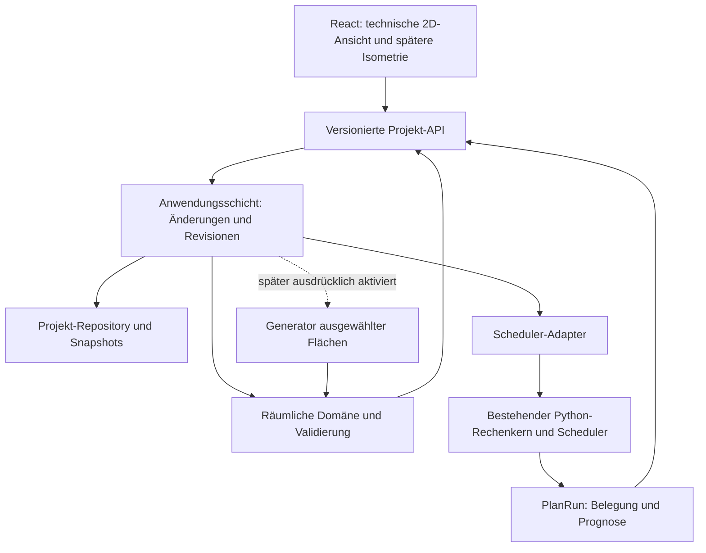

# Phase 3B.0 — Architekturentscheidung für interaktive Grundstücksplanung

Stand: 16.11.2026. **Architekturvorschlag zur Prüfung, keine Implementierung.**
Umsetzungsstand: Der getrennte Geometriekern 3B.1 ist inzwischen implementiert;
[Datenstrukturen, Tests und Konkretisierungen](phase3b1.md). Die übrigen
Abschnitte beschreiben weiterhin die Zielarchitektur späterer Phasen.
Verwandte Dokumente: [Produkt](PRODUCT.md), [Roadmap](ROADMAP.md),
[aktueller Prototyp](phase3a2.md), [Ernteprognose](phase3a2-harvest.md).

## 1. Entscheidung in Kürze

Den vorhandenen Python-Rechenkern und Scheduler erhalten. Davor eine eigene
räumliche Domäne und eine Anwendungsschicht setzen. React/SVG bleibt der
technische Editor. Zwei Ansichten projizieren dieselben metrischen Objekte;
die isometrische Ansicht besitzt keine eigene Planungsgeometrie.

Eine räumliche Revision, ein Saisonauftrag und ein reproduzierbarer
Scheduler-Lauf sind getrennte Daten. Veränderliche Arbeitsstände und
unveränderliche Varianten verweisen ausdrücklich auf diese Revisionen.
Automatische räumliche Beetgenerierung bleibt ein optionaler eigener Dienst.
Sie ist nicht mit der vorhandenen saisonalen Erstbelegung gleichzusetzen.



## 2. Bestandsaufnahme im tatsächlich vorhandenen Code

| Bestand | Wiederverwenden | Erweitern oder begrenzen |
|---|---|---|
| `models.py`, `calculator.py` | Parameter mit Einheit, Quelle, Status; Pflanzen, Saatgut, Flächen und Rundung | Keine Geometrie, Betriebskalibrierung weiterhin unvollständig |
| `database.py`, `data/cultures.json` | Strenger Kataloglader, Arten-/Sorten-/Profilbezüge | Katalog ist kein Projektarchiv; produktive saisonale Profile brauchen eigenen Eingabevertrag |
| `seasonal_models.Bed` | ID, Breite, Länge als Kapazitätseingabe | Keine Position, Rotation, Grundstücks- oder Gewächshauszuordnung |
| `SeasonalProfile`, `SeasonalTarget` | Explizite Zeiten, Ertragsperioden und Zielintervalle | Kein expliziter Umgebungsbezug zwischen Ziel und geeignetem Beet |
| `plan_season` | Reiner deterministischer Einstieg, explizites `planning_start`, bestehende Reservierungen | Keine räumliche Prüfung, keine Prioritätsoptimierung, keine manuellen Satz-Beet-Fixierungen |
| `occupancy.py` | Kapazität, Reservierungen, zeitliche Konflikte | Ganze Beete; Restfläche ist keine freie Teilbeetgeometrie; Konfliktprüfung paarweise |
| `harvest.py` | Punkt-/Dauer-/Mehrschnitt-/Lagerernte, Wochenwerte | Keine Ist-Ernten, historische Daten oder gemessenen Entwicklungsstadien |
| `prototype/demo.py` | Synthetischer End-to-End-Fall | Grenze und sechs Beete als Dictionaries; keine räumliche Fachvalidierung |
| `presentation.py` | Ableitung der Tageszustände in Python | Bereitet sämtliche Tage/Beete vor; für große Projekte später ereignisbasiert oder bereichsweise ausliefern |
| `prototype/server.py` | Lokale Startmöglichkeit | Nur `GET /api/demo`; berechnet pro Abruf neu; kein Projekt-, Schreib-, Speicher- oder Versionsvertrag |
| `types.ts` | Verständlicher Frontend-Datenvertrag | Manuell gepflegter Ausschnitt der Python-Daten, keine automatische Laufzeitvalidierung |
| `Plot.tsx` | Vollbildkarte, SVG, Kamera, Auswahl und Hover | Grundstückspolygon und Beettransformationen wiederverwenden; Wege/Nordpfeil/Hinweise teils hart codiert, keine Fachobjekte |
| `interactions.ts` | Trennung von Metern und Bildschirmraum beim Einpassen | Pointer-Pan nutzt aktuelle Bildschirm-/SVG-Achsen; für Bearbeitung inverse Welttransformation ergänzen |
| `Forecast*` | Kalenderwochenauswahl, unabhängiges Fenster, richtige Einheiten | Nur Ergebnisprojektion; nicht zum alternativen Scheduler ausbauen |
| React-Zustand | Datum, Auswahl, Fensterpositionen | Nur flüchtig; kein `localStorage`, IndexedDB oder Projekt-Repository vorhanden |

Aktueller JSON-Transport: Python-Dataclasses → `asdict` → ISO-Datumsstrings →
React `Demo`. `schema_version: 1` ist ein Demo-Vertrag, nicht die Version des
Katalogschemas 1/2. Keine dieser Versionen ersetzt eine Projektformatversion.

### Verifizierter Teststand

- 32 Python-Tests unter Python 3.11.9 erneut erfolgreich.
- 12 Frontend-Tests erneut erfolgreich; TypeScript-Prüfung ohne Ausgabe erfolgreich.
- Frontend-Testmodule und frische synthetische Scheduler-Ergebnisse wurden für
  diese Prüfung ausschließlich im separaten Prüfverzeichnis kompiliert/erzeugt.
- Kein Anwendungsbuild, kein UI-Umbau, keine neuen Abhängigkeiten installiert.
- Vorhandene Tests decken Rechenregeln, Kalendergrenzen, Wochenprognose und
  Hilfsfunktionen ab. Polygonkollisionen, Editortransaktionen, Speichern,
  Varianten und Gewächshaus-Eignung besitzen noch keine Implementierung/Tests.

## 3. Räumliche Domäne: ein verbindlicher metrischer Raum

### Koordinatenentscheidung

- Lokaler kartesischer Raum: X nach Osten/rechts, Y nach Norden/oben, Meter.
  Spätere Höhen Z nach oben; Phase 3B zunächst planar.
- Endliche Fließkommazahlen, keine Rasterbindung. Winkel in Grad gegen den
  Uhrzeigersinn, normalisiert auf `[0,360)`. Kamera und Raster sind Ansichtsparameter.
- Optionale Fanghilfen verändern Werte nur nach bewusster Nutzeraktion. Sie
  sind weder Speicherauflösung noch Voraussetzung einer schrägen Ausrichtung.
- Ein lokaler Ursprung und optional eine dokumentierte Georeferenz gehören
  zum Projekt. Ein Import geografischer Koordinaten muss ausdrücklich in ein
  geeignetes metrisches System transformiert werden; Grad sind keine Meter.
- Eigenes versioniertes JSON mit Polygonringen in Metern. Nicht als RFC-7946-
  GeoJSON ausgeben: dieser Standard verwendet WGS84 und Dezimalgrad.
  Siehe [RFC 7946](https://www.rfc-editor.org/rfc/rfc7946).

**Migrationsrisiko:** Der heutige SVG-Raum hat Y nach unten und positive
SVG-Rotation entsprechend im Bildschirmraum. Die Demo darf nicht einfach als
neue Weltkoordinaten interpretiert werden. Ihre transformierten vier Beetecken
und Grundstückspunkte werden einmalig mit `(x_svg, -y_svg)` konvertiert; daraus
werden Zentrum und Achsen abgeleitet. Für aktuelle Beete mit Winkel 0 ergibt
sich das Zentrum `(x + width/2, -y - length/2)`. Gedrehte Fälle müssen aus den
transformierten Ecken entstehen. Ein goldener Test sichert dieselbe sichtbare
Lage und Abmessung nach der Gegenprojektion. Texte bleiben auf einer lesbaren
Beschriftungsebene und werden nicht versehentlich gespiegelt.

### Vorgeschlagene Objekte

Alle Objekte tragen `object_id` (UUID, stabil), `object_revision_id`, Namen,
Herkunft (`existing`, `manual`, `generated`), optional `source_reference`,
Mess-/Datenstatus und Sperren. Herkunft und Sperren sind verschiedene Felder.
Bei der Demo-Migration wird eine feste Zuordnung von `B01` usw. zu den neuen
UUIDs geführt; die bisherige Nummer bleibt als sichtbares Label erhalten.
IDs nicht aus veränderlichen Koordinaten oder Namen ableiten. Der einmalige
Migrationslauf ist über festen Projekt-Namensraum und Legacy-ID reproduzierbar.

| Objekt | Maßgebliche Daten |
|---|---|
| `Project` | Projekt-ID, Schema, Koordinatenrahmen, Arbeitsstand und Revision |
| `Parcel` | Polygon: Außenring und Löcher, beliebige gerade Kanten; mehrere Parzellen pro Projekt möglich |
| `BedGeometry` | Zentrum, Breite, Länge, Winkel, Grundstück-ID, optional Gewächshaus-ID |
| `Path` | Explizite Nutzfläche als Polygon; optionale Mittellinie und Breite für parametrisierte Wege |
| `Obstacle` / `ExclusionZone` | Polygon, Typ und explizit geltende Abstands-/Nutzungsvorgaben |
| `GenerationZone` | Ausgewähltes Polygon, erlaubte Objektarten, Generatorparameter und Revision |
| `Greenhouse` | Gebäudegrundriss, gesonderte nutzbare Innenfläche, Tür-/Wand-/Infrastrukturflächen, Umgebungs-ID |
| `Environment` | `outdoor` oder `protected`, Quellen/Standortbezug; keine automatischen Ertragsfaktoren |

Ein Beet ist zunächst ein parametrisches Rechteck. Sein Polygon und seine
Fläche sind abgeleitet und werden nicht als zweite bearbeitbare Wahrheit
gespeichert. Lokale Breitenachse `u=(cos θ,sin θ)`, Längsachse
`v=(-sin θ,cos θ)`; Ecken `center ± width/2*u ± length/2*v`. Damit bleibt jede
Rotation erhalten. Nichtrechteckige Beete sind eine spätere ausdrückliche
Modellerweiterung: der aktuelle Scheduler darf solche Flächen nicht still auf
ein umschließendes Rechteck reduzieren.

Bei Wegen ist entweder Polygon oder Mittellinie-plus-Breite die maßgebliche
Darstellung (`geometry_mode`); die andere ist abgeleitet. Fehlt eine verlässliche
Mittellinie, ist Wegelänge **unbekannt**, nicht aus Fläche/Breite zu erfinden.

### Sperren und Hierarchie

- `geometry_locked`: keine geometrische Änderung ohne explizites Entsperren.
- `generation_protected`: Generator darf Objekt nicht ersetzen, verschieben
  oder entfernen. Bestehende/importierte Objekte sind standardmäßig geschützt.
- Eine spätere `allocation_locked`-Regel gehört zur Kulturplanung. Eine
  Geometriesperre allein fixiert keinen Satz auf einem Beet.
- Koordinaten aller Objekte bleiben im selben Weltraum. Ein Gewächshaus ist
  eine Zugehörigkeit, keine zweite lokale Geometriekopie. Beete bleiben
  individuell bearbeitbar. Gebäudeverschiebung verschiebt Kinder nur durch
  einen ausdrücklich gewählten, atomaren Gruppenbefehl; gesperrte Kinder
  blockieren ihn. Keine stille Mitbewegung.

## 4. Validierung und Änderungstransaktionen

Ein separater Python-Geometriedienst ist die maßgebliche Prüfinstanz. Empfehlung:
[Shapely/GEOS](https://shapely.readthedocs.io/en/stable/manual.html) für planare
Polygone, Einschluss, Schnittmengen und Abstände. Die Domäne speichert einfache
Datentypen, keine Shapely-Objekte im Projektformat. Keine Geometrieabhängigkeit
im bisherigen agronomischen Kern.

Prüfreihenfolge:

1. Schema, IDs/Referenzen, endliche Koordinaten, positive Maße, zulässige Ringe.
2. Polygonvalidität: keine Selbstüberschneidungen, gültige Löcher, positive Fläche.
3. Räumlicher Einschluss: Objekt liegt im Grundstück; Innenbeet vollständig in
   der nutzbaren Gewächshaus-Innenfläche. Nur ein zulässiger Elternbezug, keine Zyklen.
4. Kollisionen nach **Objektpaar-Regeln**: Beete untereinander, Wege, Hindernisse
   und Wände. Gewächshaus und zugehöriges Innenbeet dürfen sich überdecken,
   diese erlaubte Enthaltensein-Beziehung ist kein Kollisionsfehler.
5. Explizite Abstände und Zugangsregeln. Anfangs reine Geometrieprüfung;
   Erschließungsqualität ist später eine zusätzliche Prüfung.

Kantenberührung und positive Flächenüberlappung unterscheiden. Vorschlag:
gemeinsame Beetkante geometrisch zulässig, soweit keine explizite Abstandsregel
verletzt wird. Ein erforderlicher Pflegeweg muss separat modelliert werden.
Technische Vergleichstoleranz zunächst `1e-6 m`, Flächentoleranzen gesondert
dimensionsgerecht definieren und testen; keine Koordinatenschnappung auf ein
Präzisionsraster. Toleranzen sind keine Vermessungsgenauigkeit und kein
versteckter Sicherheitsabstand. Keine automatische Polygonreparatur ohne
sichtbaren Vorschlag, da sie die Nutzfläche verändern kann.

Änderung: `command_id`, `base_revision`, Objekt-ID, Änderungsart, Werte und
Ankerregel → Kandidat → Validierung → atomar übernehmen oder vollständig
ablehnen. Strukturierte Fehler nennen beteiligte IDs, Regel und betroffene
Geometrie. Keine teilweise gespeicherten Verschiebungen. Vorschau im Browser
ist möglich, endgültig gültig wird ein Objekt erst nach Python-Prüfung.

### Beispiel 65 → 75 cm

Breite in Metern: `0.65 → 0.75`; L, Winkel und Objekt-ID unverändert.
Flächendifferenz `0.10 * L` m². Für eine feste negative Breitenkante Zentrum
um `+0.05*u` verschieben; für feste positive Kante um `-0.05*u`; symmetrisch
bleibt das Zentrum gleich. Die Ankerwahl gehört zum Änderungsbefehl.

Nur dieses Objekt erhält eine neue Revision. Nachbarobjekte bleiben bitgleich;
Kollision führt zur Ablehnung, nicht zum automatischen Wegschieben der Nachbarn.
Kapazität bleibt profilabhängig: `rows * positions` nach bisherigen
Rundungskonventionen. Bei Reihenabstand 0,25 m und L=8 m, Pflanzenabstand 0,30 m:
2 → 3 Reihen, 26 Positionen je Reihe, 52 → 78 Positionen. Diese Zahlen sind
synthetischer Testfall, keine Anbauempfehlung. Bei anderem Reihenabstand muss
die Kapazität trotz größerer Fläche nicht steigen.

## 5. Räumliche Identität, Belegung und Scheduler

```text
GeometrySnapshot --object_id--> BedGeometry
     |                              |
     +--> PlanRun.inputs ---------> Scheduler Bed(id, width_m, length_m)
                                    |
SeasonPlan.targets/profiles ------> plan_season
                                    |
PlanRun --> reservations(bed_id, batch_id, window, plants)
        --> batches(target_id, profile_id)
        --> forecasts(batch_id, target_id, crop_id, week_start, unit)
```

`SchedulerAdapter` übersetzt gültige rechteckige Beete in die bestehenden
`Bed`-Objekte. Er erhält Reihenfolge ausdrücklich: diese beeinflusst die
Erstbelegung. Die Referenzbeetmaße eines Ziels bleiben Bedarfskennzahlen und
sind keine zweite Geometrie des zugewiesenen Beetes.
Zielvertrag: Scheduler-`bed_id` entspricht der räumlichen `object_id`. Beim
Alt-/Neu-Vergleich der Demo werden die Legacy-Beet-IDs ausdrücklich auf die
UUIDs abgebildet; Mengen, Termine und Zuweisungsstruktur müssen danach gleich
sein. Ein bloßer Vergleich der unveränderten alten Zeichenketten wäre falsch.

Ein `PlanRun` enthält `run_id`, Geometrie-/Saisonrevisionen, vollständige
Eingabeschnappschüsse einschließlich Profile/Quellen, Kern-/Adapterversion,
geordnetes Beetangebot und Ergebnisse. Jeder Ergebnisbezug wird zusammen mit
`run_id` gelesen. Aktuelle Satz-IDs `target_id:index` sind laufbezogen und
können sich bei geänderter Satzaufteilung verschieben. Nicht als dauerhafte
Kulturzyklus-ID über Varianten hinweg verwenden. Später eigene
`cultivation_intent_id` und eine dokumentierte Run-/Batch-Zuordnung ergänzen.

Die Wochenprognose bleibt aus `quantity` ausgewählter Scheduler-Wochen;
`credited_quantity` betrifft nur Zielanrechnung. Tagesstatus und Wochenereignis
bleiben unabhängig. BedReservation verknüpft die Beete eindeutig mit dem Satz.
Ein Satz kann mehrere Beete belegen: die heutige Prognose ist satz-, nicht
beetgenau. Eine spätere Aufteilung auf Beete nach Pflanzenanteilen wäre eine
explizite Gleichverteilungsannahme, keine bereits vorhandene Messung.

**Wichtig bei Geometrieänderung:** Flächen/Kapazitäten des bearbeiteten Beetes
sofort als neue Ableitungen berechnen, bisherige Saisonergebnisse aber als
`stale` kennzeichnen. Sie gehören weiterhin zur alten Geometrie. Ein kompletter
Scheduler-Neulauf kann Belegungen anderer Beete ändern. Er erfolgt bewusst mit
Vorschau; eine spätere Erweiterung für fixierte Zuweisungen muss eigene
Konfliktregeln erhalten. `existing_reservations` allein genügt dafür nicht:
es blockiert Fläche, erzeugt für externe Reservierungen keine neue Prognose
und lehnt kollidierende neu erzeugte Satz-IDs ab.

## 6. Zwei Planungsabläufe

### A: Neues Grundstück

Grenze erfassen/importieren → validieren → manuell Beete anlegen **oder**
ausdrücklich Generator mit Richtung, Maßen, Wegen und ausgewählter Zone starten
→ Vorschau prüfen → bestätigen → getrennte Saisonplanung starten.

### B: Bestehender Market Garden

Grenze und Bestand übernehmen, ggf. manuell nachzeichnen → Quellen/Genauigkeit
kennzeichnen → bestehende Beete/Wege/Gewächshäuser zuordnen → Geometrie prüfen
→ Saisonplanung. Keine automatische räumliche Platzierung beim Import, Öffnen,
Speichern oder Scheduler-Aufruf. Bestand standardmäßig generatorgeschützt.

### Kombiniert

Bestand schützen → ausgewählte freie `GenerationZone` festlegen → verfügbare
Fläche aus Zone minus Hindernissen, geschützten Objekten und expliziten
Abständen ableiten → nur darin neue Objekte vorschlagen. Generatoränderung
enthält ausschließlich neue oder ausdrücklich freigegebene Objekte. Bereits
vorhandene IDs/Geometrien bleiben erhalten. Ungültiger Bestand wird gemeldet,
nicht automatisch korrigiert. Generatorparameter, Seed und Version speichern;
deterministische Vorschau ist noch keine mathematische Optimierungsgarantie.

## 7. Gewächshäuser und Anbaubedingungen

Gebäudegrundriss, produktiv nutzbare Innenfläche und Innenbeete getrennt führen.
Für Freiland-Generierung das ganze Gebäude als Hindernis behandeln; für
Innenplanung die nutzbare Innenfläche minus interne Sperren/Wege verwenden.
Innenbeete sind keine zusätzliche Nutzfläche außerhalb der Gebäudehülle.

Saisonprofile erhalten später einen expliziten Standort-/Umgebungsbezug.
Ein Ziel mit geschütztem Profil darf nicht still auf ein Freilandbeet geraten.
Der vorhandene Allocator hat keinen solchen Eignungsfilter. Deshalb zunächst
Umgebungsgruppen getrennt mit passenden Beetangeboten planen und je Gruppe
belegen; Ziele nicht doppelt an mehrere Gruppen verteilen. Gemeinsame Konkurrenz
verschiedener Umgebungen erfordert später eine getestete Kompatibilitätsregel
im Allocator. Bis dahin übergreifende Mehrdeutigkeit ablehnen.

Keine pauschalen Ertrags- oder Wachstumsfaktoren. Fehlende geschützte Profile
blockieren die betroffene Prognose mit einer Datenmeldung. Ein Beet bleibt
räumlich darstellbar, auch wenn dafür noch kein agronomisch belegtes Profil existiert.

## 8. Speicherung und Bake-System

### Vorschlag für logische Datenstrukturen

```text
Project(project_id, schema_version, coordinate_frame)
WorkingPlan(workspace_id, project_id, revision, base_variant_id, object_refs, season_refs)
ObjectRevision(object_id, object_revision_id, kind, payload, content_hash)
GeometrySnapshot(snapshot_id, project_id, object_refs, geometry_policy_version)
SeasonSnapshot(season_snapshot_id, targets, profiles, reservations, input_sources)
PlanRun(run_id, geometry_snapshot_id, season_snapshot_id, versions, result, input_hash)
BakedVariant(variant_id, project_id, parent_variant_id, geometry_snapshot_id,
             season_snapshot_id, run_ids, metrics_version, created_at, content_hash)
```

Ein Bake friert vollständige Eingaben ein. Ergebnisse dürfen als explizit
fehlend/fehlgeschlagen gespeichert werden, aber niemals als vergleichbarer
aktueller Ertrag gelten, wenn sie veraltet sind. Ein identischer Eingabehash
schließt die Implementierungsversion, Regeln und Reihenfolgen mit ein.

Bake ist eine unveränderliche Kopie, kein Verweis auf veränderliche Dictionaries
oder aktuelle Kulturdaten. `frozen=True` schützt heutige verschachtelte Listen/
Dictionaries nicht tief; Serialisierung und unveränderliche Repository-Regeln
sind nötig. Duplizieren erzeugt neuen Arbeitsstand/Varianten-ID, erhält aber
die logischen Objekt-IDs. Ein tatsächlich neu dupliziertes Beet erhält dagegen
eine neue Objekt-ID mit `derived_from_object_id`. Gelöschte IDs nicht recyceln;
Abstammungsbezüge bei Aufteilen/Zusammenlegen ausdrücklich speichern.

Schlüssel einer Objektrevision ist projektbezogen `(object_id, object_revision_id)`;
Snapshots referenzieren eine feste Revision. Hash dient Integritätsprüfung,
nicht als Ersatz für Objektidentität. Vergleich kann dadurch unverändert,
geändert, hinzugefügt und entfernt unterscheiden.

### Vergleichsgrößen und faire Vergleichsbasis

- Grundstücksfläche, Beetflächen und vereinigte produktive Fläche getrennt;
  Gewächshaus-Hülle und Innenbeete niemals doppelt als Anbaufläche zählen.
- Wegeflächen vereinigen; Wegelänge als explizit definierte Mittellinienlänge
  mit ausgewiesener Regel für gemeinsame Abschnitte/Kreuzungen.
- Erntemengen nach Kultur, Einheit und Woche; kg und Stück nicht addieren.
- Gleicher Zeitraum, Ziele und Profilrevisionen für einen Geometrievergleich.
  Abweichende Agronomie/Engine-Versionen offen anzeigen; sonst keine kausale
  Aussage „mehr Ertrag durch andere Geometrie“. Fehlende Prognose ≠ Nullertrag.

Für lokale Speicherung SQLite hinter einem Repository vorsehen. Transaktionen
ermöglichen atomare Projekt-/Bake-Schreibvorgänge; siehe
[SQLite-Transaktionen](https://www.sqlite.org/transactional.html). Zunächst
versionierten JSON-Import/-Export zur Sicherung und Migration unterstützen.
Für einzelne JSON-Dateien: temporäre Datei und atomarer Austausch mit sauberer
Fehlerbehandlung. Kein Zwang zu PostGIS oder Cloudkonto. Späterer Webbetrieb
verwendet dieselben Domänen-/API-Verträge, ergänzt Authentisierung,
projektbezogene Rechte und einen für Mehrbenutzerbetrieb geeigneten Speicher.

## 9. API, Revisionen und Modulgrenzen

Zukünftige Module: `spatial/models`, `spatial/geometry`, `spatial/validation`,
`application/commands`, `application/scheduler_adapter`, `repositories`,
`api/contracts`, `api/routes`. Der bestehende Kern bleibt separat importierbar.

Vorgeschlagene versionierte Schnittstellen, **noch nicht vorhanden**:

- `GET /api/v1/projects/{id}`: Arbeitsstand und Revision.
- `POST .../commands/preview`: Kandidat und Fehler ohne Speicherung.
- `POST .../commands`: atomare Änderung mit `base_revision`/`command_id`.
- `POST .../plan-runs`: explizite Berechnung eines Eingabeschnappschusses.
- `POST .../variants`: Bake; `POST .../variants/{id}/duplicate`: neuer Arbeitsstand.

Veraltete Basisrevision → Konflikt statt Überschreiben; wiederholte Command-ID
idempotent behandeln. Während einer Vorschau ist nur deren Ergebnis gültig;
verspätete Serverantworten dürfen keinen jüngeren Editorzustand überschreiben.
Undo/Redo zunächst über begrenzte Befehlshistorie, kein umfassendes Event-Sourcing.

Für diese Schreibschnittstellen FastAPI/Pydantic als äußerer Adapter empfehlen:
Validierung und OpenAPI-Vertrag reduzieren parallele handgepflegte Modelle.
Siehe [FastAPI](https://fastapi.tiangolo.com/features/). TypeScript-Typen später
aus dem Vertrag generieren, Parserfehler trotzdem sichtbar behandeln. Für das
rein lesende 3B.1-Domänenpaket ist der Serverwechsel noch nicht nötig.

## 10. Zwei Ansichten derselben Objekte

Technisch 2D: Weltpunkt → Kamera → SVG; Bearbeitung verwendet die inverse
Transformation. Das Grundstücksraster darf verschwinden, ohne die Daten zu
ändern. Rotation und Maßangaben gehören zum Objekt, nicht zur Kamera.

Isometrisch: dieselben Weltpunkte nach einer festen Kamerarotation projizieren,
z.B. `screen_x=s*(x-y)`, `screen_y=s*((x+y)/2-z)`. Gebäudedächer und Pflanzen
verwenden abgeleitete Darstellungsdaten/Höhen; ihre Grundflächen bleiben die
gleichen Polygone. Ein Beet mit 17° bleibt vor der Projektion 17° gedreht.
Kein Nachzeichnen auf Kacheln, kein unabhängiger Pixel-/Tile-Grundriss.

Pflanzenzeichen werden an aus derselben Beetgeometrie abgeleiteten Positionen
platziert. Sprite-/Pixel-Stil darf Silhouetten vereinfachen, aber weder
Grundstücksgrenze, Beetrichtung noch Auswahl-/Kollisionsgeometrie ersetzen.
Saisonphasen liefert weiterhin Python; schematische Wachstumsbilder werden als
solche gekennzeichnet. Technische Maße gelten in 2D, nicht als unverzerrte
Bildschirmstrecken in der Isometrie.

Gestaltung: **Monochrome Living Landscape** — Weiß/Grau, ruhige Konturen,
wenige dezente Zustandsakzente, sachliche Beschriftung. Terra Nil ist visuelle
Inspiration für Landschaftsruhe, keine Vorgabe für Spielmechanik oder Raster.
Bestehende funktionale Farben nicht in diesem Architekturauftrag austauschen.

## 11. Risiken und Entscheidungen

| Risiko | Konsequenz / Maßnahme |
|---|---|
| SVG-/Weltachsen vermischt | Spiegelungen, falsche Rotation; explizite Migration plus Eckpunkt-/Inverse-Tests zuerst |
| Neue Beetmaße + alter PlanRun | Falsche Kapazität/Prognose; Revisionen und Stale-Anzeige vor automatischer Neuberechnung |
| Globaler First-fit-Neulauf | Andere Belegungen ändern sich; bewusste Vorschau, spätere Fixierungen separat modellieren |
| Unvollständige Agronomie | Geometrie ist planbar, reale Erträge nicht vollständig; keine Ersatzwerte |
| Standardkollisionen bei Hierarchien | Innenbeete fälschlich abgelehnt; objektpaar- und kontextabhängige Regeln |
| Float-/Topologiefehler | Explizite Toleranzen, robuste Bibliothek, keine stillen Reparaturen/Rasterzwänge |
| Veränderliche Bake-Eingaben | Nicht reproduzierbare Varianten; tief eingefrorene Eingaben und Versionen |
| Frontend/Python-Vertragsdrift | Typen allein sichern JSON nicht; versionierter validierter API-Vertrag |
| Windows-Paketierung | GEOS-Wheels und Python-3.11-Kompatibilität vor Versionsfestlegung testen; kein Installationsversprechen aus Architektur allein |
| Skalierung | Tagesmatrix und paarweise Konflikte wachsen; erst messen, danach Ereignislisten/STRtree, nicht vorschnell alles ersetzen |
| Verwechslung Bestand/Generator | Bestehenden Garten unbeabsichtigt umbauen; Generator nur ausdrücklich und zonenbezogen aktivieren |

Bibliotheken: Shapely als räumliche Erweiterung; `dataclasses`, `uuid`, `json`
und später `sqlite3` aus der Standardbibliothek. FastAPI/Pydantic erst mit
Schreib-API. React/TypeScript/SVG weiterverwenden. Derzeit weder GIS-Framework,
zweite JavaScript-Geometrie-Engine noch 3D-Engine erforderlich. Versionsauswahl
und Windows-Installation werden Bestandteil der jeweiligen Implementierungsphase.
